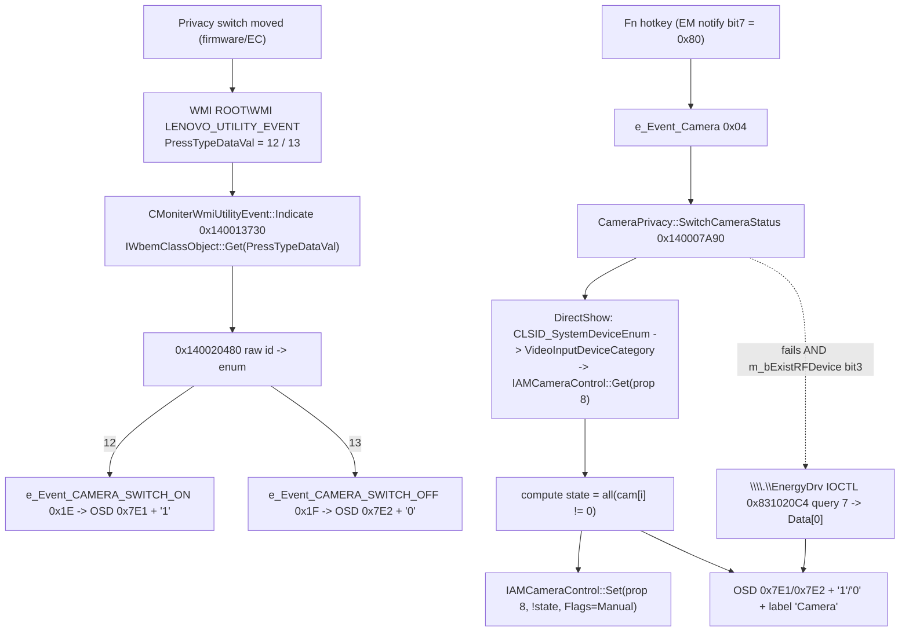

# Ghidra RE report — `FnHotkeyUtility.exe` (Lenovo Fn and function keys 2.0.0.25, 2022-04-25)

Task 05 deliverable. Answers questions 1–4 of `tasks/05-ghidra-fnhotkey.md` for the camera switch.

**Binary:** `$W/10-extracted/code$getextractpath$/source/fnhotkeyutility.exe`
PE32+ x86-64, image base `0x140000000`, 785 240 bytes, TimeDateStamp `0x625805AB` (2022-04-25).
Sections: `.text 0x1000..0x29F5C` (raw `0x400`), `.rdata 0x2B000..0x54F90` (raw `0x29600`), `.pdata`, `.data 0x55000` (raw `0x53600`), `.rsrc`.

**Tooling / how to reproduce.** Ghidra 12.1.2 headless (`/opt/ghidra/support/analyzeHeadless`), JDK 27:
```
analyzeHeadless /tmp/ghidra-proj FnHotkey -import <exe> \
  -scriptPath $W/50-ghidra/scripts -postScript DumpFnHotkey.java $W/50-ghidra/fnhotkeyutility
analyzeHeadless /tmp/ghidra-proj FnHotkey -process fnhotkeyutility.exe -noanalysis \
  -scriptPath $W/50-ghidra/scripts -postScript DumpVtables.java     $W/50-ghidra/fnhotkeyutility
analyzeHeadless /tmp/ghidra-proj FnHotkey -process fnhotkeyutility.exe -noanalysis \
  -scriptPath $W/50-ghidra/scripts -postScript DecompileAddrs.java  <out> <addr> [addr...]
```
Cross-checks were done with `objdump -d -M intel --section=.text` (saved as `/tmp/fnh.asm` during the run) and `pefile`.
MSVC RTTI/vtable recovery gave real class names (`CMoniterWmiUtilityEvent`, `CMoniterWmiGetFnQ`, `DAX::CDolbyDAX`, `CMMPlatform`, …); everything else is `FUN_<addr>`.

**Raw artifacts in this directory**

| file | content |
|---|---|
| `decompile.txt` | Decompilation of every function that references an interesting string/class name (5 447 lines) |
| `decompile-sinks.txt` | Decompilation of the two `IWbemObjectSink` implementations (QueryInterface/AddRef/Release/Indicate/SetStatus) |
| `decompile-helpers.txt` | `FUN_1400184a0` (OSD), `FUN_140008a80` (EM IOCTL wrapper), `FUN_140008b60`, `FUN_140012380` |
| `vtables-decompile.txt` / `vtables.txt` | RTTI vtables + targets. Note: entries labelled `*_meta_ptr` are dumped one slot early; use the `::vftable` blocks |
| `symbols.txt` | All 655 recovered functions (addr, size, name) |
| `stringrefs.txt` | Every interesting string → referencing code address + function |
| `named-functions.txt`, `disasm-named.txt` | name-filtered extras |
| `../scripts/*.java` | the three dump scripts (reproducible) |

**Addressing convention:** all addresses are program virtual addresses (`0x1400xxxxx`). File offsets are given for the GUID blocks only.
**Symbol names** (`MsgLogic::g_HandleEvent`, `CameraPrivacy::SwitchCameraStatus`, …) are taken from the log-string prefixes the authors put in the code plus MSVC RTTI for the WMI classes; the numeric address is always authoritative.

---

## TL;DR for the Linux driver

* The camera **switch position** is reported to the OS by firmware through the **WMI utility-event class `LENOVO_UTILITY_EVENT` in `ROOT\WMI`**, property **`PressTypeDataVal`**:
  `12 (0x0C)` = *camera switch ON*, `13 (0x0D)` = *camera switch OFF*. **Certain** (constant + call site + property name all verified).
* `FnHotkeyUtility.exe` does **not** read the switch position from WMI at key-press time. It reads it from the **USB camera itself**: it enumerates DirectShow video-capture devices (`CLSID_SystemDeviceEnum` / `CLSID_VideoInputDeviceCategory`) and calls `IAMCameraControl::Get(property = 8, …)` on every camera. `property 8` is outside the documented `CameraControlProperty` range `0..6`, i.e. a **vendor (UVC "privacy"/shutter) control**. Fallback when that fails: EM-driver IOCTL `0x831020C4`, input dword `7`, output dword `Data[0]`.
* The **hotkey** path used on this machine is: `\\.\EnergyDrv` notify-state **bit 7 (`0x80`)** → internal event `e_Event_Camera` (id `4`) → `CameraPrivacy::SwitchCameraStatus()` **toggles** the DirectShow property. The *capability* bit that enables this path is **`CAMERA_BIT7` = bit 7 of byte 3 (bits 31..24) of the 4-byte `GetGpioInfo` result of IOCTL `0x831020DC`**.
* No camera state is read from the registry, and SetupAPI is used only for **HID** device enumeration (`GUID_DEVINTERFACE_HID`), never for the camera.

---

## 1. Which WMI class/namespace and how the event data is decoded

### 1.1 Event source — `CMoniterWmiUtilityEvent` (certain)

`CMoniterWmiUtilityEvent::_Thread_WmiUtilityEventMonitor` = **`FUN_140013800` @ `0x140013800`** (1 100 bytes), `decompile.txt:667-834`.
It is started from the OSD/message window procedure `FUN_14000ca40` (`WM_CREATE`, `decompile.txt:1836-1846`, log `"MoniterWmiUtilityEvent StartUtilityEventMonitor Monitor LSKEvent button done."`).

Sequence (exact, `decompile.txt:700-800`):

```c
CoInitializeEx(NULL, COINIT_MULTITHREADED /*0*/);
SetThreadPriority(GetCurrentThread(), THREAD_PRIORITY_BELOW_NORMAL /*2*/);
CoInitializeSecurity(NULL,-1,NULL,NULL, 0 /*RPC_C_AUTHN_LEVEL_DEFAULT*/,
                     3 /*RPC_C_IMP_LEVEL_IMPERSONATE*/, NULL, 0, NULL);
CoCreateInstance(&DAT_14002bdd8 /*CLSID_WbemLocator*/, NULL, 1 /*CLSCTX_INPROC_SERVER*/,
                 &DAT_14002bdf8 /*IID_IWbemLocator*/, &pLoc);
pLoc->ConnectServer(L"ROOT\\WMI", 0,0,0, 0,0,0,0, &pSvc);          // IWbemLocator vtbl +0x18
log(L"MoniterWmiUtilityEvent _Thread_WmiUtilityEventMonitor Connected to ROOT\\WMI WMI namespace\n");
CoSetProxyBlanket(pSvc, 10 /*RPC_C_AUTHN_WINNT*/, 0, NULL, 3, 3, NULL, 0);
CoCreateInstance(&DAT_14002bdc8 /*CLSID_UnsecuredApartment*/, NULL, 4 /*CLSCTX_LOCAL_SERVER*/,
                 &DAT_14002be08 /*IID_IUnsecuredApartment*/, &pUnsec);
sink = new CMoniterWmiUtilityEvent;  sink->vtbl = CMoniterWmiUtilityEvent::vftable;
pUnsec->CreateObjectStub(sink, &pStubUnk);                       // IUnsecuredApartment vtbl +0x18
pStubUnk->QueryInterface(&DAT_14002bde8 /*IID_IWbemObjectSink*/, &pStubSink);
pSvc->ExecNotificationQueryAsync(L"WQL",
        L"SELECT * FROM LENOVO_UTILITY_EVENT",   // SysAllocString, exact ANSI string
        0x80 /*WBEM_FLAG_SEND_STATUS*/, NULL, pStubSink);        // IWbemServices vtbl slot 7
```

GUID constants (verified byte-exact against the import/IDL definitions):

| VA (file off) | value | name |
|---|---|---|
| `0x14002bdd8` (`0x2A3D8`) | `{4590F811-1D3A-11D0-891F-00AA004B2E24}` | `CLSID_WbemLocator` |
| `0x14002bdf8` (`0x2A3F8`) | `{DC12A687-737F-11CF-884D-00AA004B2E24}` | `IID_IWbemLocator` |
| `0x14002bde8` (`0x2A3E8`) | `{7C857801-7381-11CF-884D-00AA004B2E24}` | `IID_IWbemObjectSink` |
| `0x14002bdc8` (`0x2A3C8`) | `{49BD2028-1523-11D1-AD79-00C04FD8FDFF}` | `CLSID_UnsecuredApartment` |
| `0x14002be08` (`0x2A408`) | `{1CFABA8C-1523-11D1-AD79-00C04FD8FDFF}` | `IID_IUnsecuredApartment` |
| `0x14002bcf0` (`0x2A2F0`) | `{00000000-0000-0000-C000-000000000046}` | `IID_IUnknown` |

The query string `"SELECT * FROM LENOVO_UTILITY_EVENT"` is **ANSI**, at VA `0x14003F440` (`70-evidence/strings-fnhotkeyutility.exe.txt:2872`).

**⇒ Namespace `ROOT\WMI`, class `LENOVO_UTILITY_EVENT`, WQL `SELECT *`, asynchronous push (`ExecNotificationQueryAsync`), event object = `IWbemClassObject`.** Certain.

The `CMoniterWmiUtilityEvent` vtable (`vtables.txt`, block `@0x14003F550`):

| slot | address | method |
|---|---|---|
| 0 | `0x140013040` | `QueryInterface` — accepts only `IID_IUnknown` or `IID_IWbemObjectSink`, else `E_NOINTERFACE (0x80004002)` |
| 1 | `0x140012FF0` | `AddRef` |
| 2 | `0x1400136F0` | `Release` |
| 3 | **`0x140013730`** | **`Indicate`** ← event decoding |
| 4 | `0x1400137C0` | `SetStatus` (only logs) |

### 1.2 `Indicate` — the property that carries the event id (certain)

`CMoniterWmiUtilityEvent::Indicate` = **`FUN_140013730` @ `0x140013730`** (133 bytes), `decompile-sinks.txt:73-105`; disassembly verified byte-for-byte:

```asm
140013730  ; HRESULT Indicate(long lObjectCount /*edx*/, IWbemClassObject **apObjArray /*r8*/)
140013751  lea  rcx,[rsp+0x30]                 ; VARIANT vtVar
140013756  call qword ptr [0x14002b488]        ; OLEAUT32!VariantInit
14001375c  mov  rcx,[rbx]                      ; rcx = apObjArray[i]  (IWbemClassObject*)
14001375f  lea  r9,[rsp+0x30]                  ; pVal  = &vtVar
140013764  mov  qword ptr [rsp+0x28],rbp       ; plFlavor = NULL
140013769  lea  rdx,[rip+0x2b6a0]              ; rdx = 0x14003EE10 = L"PressTypeDataVal"
140013770  xor  r8d,r8d                        ; lFlags = 0
140013773  mov  qword ptr [rsp+0x20],rbp       ; pType = NULL
140013778  mov  rax,[rcx]
14001377b  call qword ptr [rax+0x20]           ; IWbemClassObject::Get(GetQualifierSet=+0x18, Get=+0x20)
14001377e  mov  esi,dword ptr [rsp+0x38]       ; esi = vtVar.lVal  (VARIANT+8 → VT_I4 value)
140013787  call qword ptr [0x14002b4c8]        ; OLEAUT32!VariantClear
   ... loop lObjectCount times, apObjArray += 8 ...
14001379c  mov  ecx,esi
14001379e  call 0x140020480                    ; WMIMonitorMsgCenter utility-event handler
```

* vtable slot `+0x20` = index 4 of `IWbemClassObject` = **`Get`** (index 3 is `GetQualifierSet`; confirmed against `wbemcli.h`).
* Property name: **`PressTypeDataVal`**, UTF-16, VA `0x14003EE10`.
* Value: `VARIANT.lVal` (offset `+8` of the VARIANT on the stack) — i.e. the firmware sends the event id as a **4-byte integer**, not a string. Property type/flavor are not requested.
* The loop only *keeps the last* object's value (each iteration overwrites `esi`), then calls `0x140020480` once. With the classic single-event notification this is equivalent to "use `apObjArray[0]`".

### 1.3 `WMIMonitorMsgCenter` — the raw-id → MsgLogic-event dispatcher (certain)

**`FUN_140020480` @ `0x140020480`** (1 128 bytes), `decompile.txt:5249-5393`, trace string `"WMIMonitorMsgCenter g_UtilityEvent UtilityLSK2.0Status  wParam=%d"` (`0x1400472C0`).

```c
void WMIMonitorMsgCenter_UtilityLSK20(int wParam /* = PressTypeDataVal */, ...) {
    log("WMIMonitorMsgCenter g_UtilityEvent UtilityLSK2.0Status  wParam=%d");
    if ((unsigned)wParam - 1 < 0x29) {              // accept only 1..0x29 = 1..41
        switch (wParam) { ... }                     // jump table @ 0x1400208E8 (41 x int32, offsets from image base)
        // bodies start at 0x1400204BD..0x1400208C7; 10 (0x0A) and 11 (0x0B) branch to 0x1400208D4
    }
    log("WMIMonitorMsgCenter g_UtilityEvent UtilityLSK2.0Status  wParam invalid");   // 0x140047350
}
```
`0x1400208D4` loads `0x140047350` = the `wParam invalid` string, i.e. **raw ids 10 and 11 and anything outside 1..0x29 are rejected**.

I decoded the 41-entry jump table straight from the file (raw offset `0x1FCE8`, `rel32` entries, dispatch `jmp image_base+rel`) and read the constant each body stores into `[rsp+0x38]` (handler id, low dword) + `[rsp+0x3C]` (sub-parameter = raw id, high dword). Both the decompiler output and this raw decode agree:

| raw `PressTypeDataVal` | → handler id | `e_Event_*` name |
|---|---|---|
| `0x00`/out of range | — | rejected, logs `wParam invalid` |
| `0x01` | `0x12` | `e_Event_LSK_2_WMI` (generic LSK 2.0 key) |
| `0x02` | `0x1A` | `e_Event_FNLK_ON` |
| `0x03` | `0x1B` | `e_Event_FNLK_OFF` |
| `0x04` | `0x19` | `e_Event_SNAP_TOOL` (+ sub-param) |
| `0x05` | `0x15` | `e_Event_VOIP_ANSWER` (+ sub) |
| `0x06` | `0x16` | `e_Event_VOIP_END` (+ sub) |
| `0x07` | `0x1C` | `e_Event_SERVICE` |
| `0x08` | `0x14` | `e_Event_LSK_CLICK` (+ sub) |
| `0x09` | `0x1D` | `e_Event_VOICE` |
| `0x0A` | — | **rejected** (`wParam invalid`) |
| `0x0B` | — | **rejected** (`wParam invalid`) |
| **`0x0C`** | **`0x1E`** | **`e_Event_CAMERA_SWITCH_ON`** |
| **`0x0D`** | **`0x1F`** | **`e_Event_CAMERA_SWITCH_OFF`** |
| `0x0E` | `0x17` | `e_Event_VOIP_ANSWER_2` (+ sub) |
| `0x0F` | `0x18` | `e_Event_VOIP_END_2` (+ sub) |
| `0x10` | `0x20` | `e_Event_PANEL_RFESHRATE` |
| `0x11` | `0x12` | `e_Event_LSK_2_WMI` |
| `0x12` | `0x22` | `e_Event_DOLBY_THREE_MODE` |
| `0x13` | `0x23` | `e_Event_NIGHT_SCREEN_MODE` |
| `0x14` | `0x24` | `e_Event_GAMELOGO_FNL_ON` |
| `0x15` | `0x25` | `e_Event_GAMELOGO_FNL_OFF` |
| `0x16` | `0x26` | `e_Event_PLUGIN_LED_FNU_ON` |
| `0x17` | `0x27` | `e_Event_PLUGIN_LED_FNU_OFF` |
| `0x18` | `0x28` | `e_Event_KBDBRIGHT_OFF` |
| `0x19` | `0x29` | `e_Event_KBDBRIGHT_L1` |
| `0x1A` | `0x2A` | `e_Event_KBDBRIGHT_L2` |
| `0x1B` | `0x2C` | `e_Event_RGB_KBD_LE_WAVE` |
| `0x1C` | `0x2D` | `e_Event_RGB_KBD_LE_BREATH` |
| `0x1D` | `0x2E` | `e_Event_RGB_KBD_LE_SMOOTH` |
| `0x1E` | `0x2F` | `e_Event_RGB_KBD_LE_ALWAYS` |
| `0x1F` | `0x30` | `e_Event_RGB_KBD_LE_OFF` |
| `0x20` | `0x31` | `e_Event_RGB_KBD_LE_RAINBOW` |
| `0x21` | `0x32` | `e_Event_RGB_KBD_LE_BLUE` |
| `0x22` | `0x33` | `e_Event_RGB_KBD_LE_RIPPLE` |
| `0x23` | `0x34` | `e_Event_RGB_KBD_LE_RAINING` |
| `0x24` | `0x36` | `e_Event_RGB_KBD_LE_AWAVELR` |
| `0x25` | `0x35` | `e_Event_RGB_KBD_LE_AWAVEM` |
| `0x26` | `0x2B` | `e_Event_KBDBRIGHT_L3` |
| `0x27` | `0x38` | `e_Event_SERVICE_KEY_C970` |
| `0x28` | `0x39` | `e_Event_CAMERA_BG_BLUR` |
| `0x29` | `0x3A` | `e_Event_PTP_TOUCHPAD` |

(the `0x24↔0x25` and `0x1B→0x2C` irregularities are in the firmware/Windows contract as written — they are reproduced exactly as decoded.)

**This answers the "camera switch" question for Windows: the physical privacy-switch movement is delivered as `PressTypeDataVal = 12` (ON) / `13` (OFF) on `ROOT\WMI:LENOVO_UTILITY_EVENT`.** Note both produce the same OSD strings/assets as the Fn-key path (see §2.3), and neither performs any hardware write — they are pure notifications.

### 1.4 `CAMERA_BIT7` — what it really is (certain)

`CAMERA_BIT7` is **not** part of the WMI event payload. It is a **capability bit of the EM (EnergyDrv) driver GPIO report**, read once during `MsgLogic::g_HandleEvent` init (`decompile.txt:2400-2504`, disassembly `0x14001AAC3-0x14001AC00`):

```c
hEM = CreateFileW(L"\\\\.\\EnergyDrv", 0xC0000000 /*GENERIC_READ|WRITE*/, 3, NULL,
                  OPEN_EXISTING /*2*/, FILE_ATTRIBUTE_NORMAL /*0x80*/, NULL);   // 0x140056140
DeviceIoControl(hEM, 0x831020DC /* "GetGpioInfo" */, NULL, 0, &gpio, 4, &ret, NULL);  // out = [rsp+0xE0]
DWORD cap = gpio >> 0x18;                 // >>> byte 3 = bits 31..24 of the 4-byte answer
DAT_1400560FC = cap;                      // 0x1400560FC
//   bit7 (0x80) -> CAMERA_BIT7   : DAT_140056148 = (cap & 0x80) != 0   ("m_OsdSupport CAMERA_BIT7")
//   bit6 (0x40) -> TOUCHPAD_BIT6 : DAT_14005614C
//   bit5 (0x20) -> MIC_BIT5      : DAT_140056150
//   bit3 (0x08) -> NUMLK_BIT3    : DAT_140056158
if (cap & 0x80 == 0) log(L"MsgLogic g_HandleEvent Init CAMERA_BIT7 fail! ...");  // 0x140042C20
```

Exact disassembly of the extraction (`0x14001AB60`):
```asm
14001ab60  mov eax,dword ptr [rsp+0xe0]
14001ab67  shr eax,0x18                 ; -> byte 3
14001ab6a  mov dword ptr [0x1400560fc],eax
14001abb2  ...  test al,al / js ...     ; 'char cap < 0'  == bit7 set
14001abd2  mov dword ptr [0x140056148],<0|1>   ; = !(bit7 clear)
```
Note the log message is emitted when the bit is **clear** ("fail!"), and the stored flag `DAT_140056148` is **1 when bit7 is SET**. Reading of the byte is a **signed** `char` test (`js`), so only bit 7 is inspected.

* **Meaning: `CAMERA_BIT7 == 1` → this platform supports the camera hotkey/OSD path (`m_OsdSupport`); `== 0` → the camera event is ignored (`case 4:` starts with `if (DAT_140056148 != 1) break;`).**
* On IOCTL failure the code stores the default `DAT_1400560FC = 0xF8` (`0x14001AB88`), i.e. bits 7,6,5,4,3 set ⇒ **camera/touchpad/mic/numlk considered supported by default**.
* Addresses: capability byte `0x1400560FC`, camera flag `0x140056148`, touchpad `0x14005614C`, mic `0x140056150`, numlk `0x140056158`.

A **second** `GetGpioInfo` call (same IOCTL, `0x14001ACC3`) stores `byte3`… precisely: `DAT_140056160 = (BYTE)(gpio2 >> 16)` — **byte 2 (bits 23..16)** of the same 4-byte answer — and is named `m_bExistRFDevice`; `case 4` tests **`DAT_140056160 & 8`** (bit 3) as "the EM driver can report the camera state".

### 1.5 The **hotkey** path: `e_Event_Camera` comes from EM notify bit 7 (certain)

`FUN_140008FD0` (`0x140008FD0`, 725 bytes, `decompile.txt:168-294`) is the `\\.\EnergyDrv` notification handler (`m_EMNotifyEvent`, called from the notify thread `FUN_140008B60`). It is pure bit decoding of the notify DWORD (`param_2`):

```c
log(L"EMDriverMsgCenter CKernelLib m_EMNotifyEvent %d = %x");
if (param_2 & 0x01)             g_HandleEvent(0x00);                    // OnekeyStudio_ITS
if ((char)param_2 < 0) { Sleep(100); g_HandleEvent(0x04); }             // bit7  (0x80) -> e_Event_Camera
if ((param_2 >> 8)  & 1)        g_HandleEvent(0x0B);                    // bit8  -> Mic
if ((param_2 >> 13) & 1)        g_HandleEvent(0x08);                    // bit13 -> Airplane
if (param_2 & 0x20)             g_HandleEvent(0x03);                    // bit5  -> Touchpad(SPDIF_TouchPad)
if ((param_2 >> 12) & 1) ...    g_HandleEvent(0x02);                    // bit12 -> Backlight
                                 // bit12 also triggers IOCTL 0x831020C4 with query 0x15 ...
```

`e_Event_Camera` (handler id `4`) is produced **only here** — I enumerated all 48 call sites of `MsgLogic::g_HandleEvent` (`FUN_14001AA60`) and the only one passing `0x4` is `0x140009021` (bit7 branch of `FUN_140008FD0`).

Likewise `0x1E`/`0x1F` (`CAMERA_SWITCH_ON`/`OFF`) are produced **only** by raw WMI ids `0x0C`/`0x0D` (`0x1400205FB` / `0x140020616`).

---

## 2. WMI event data → `MsgLogic` event enum, and what each camera-related id does

### 2.1 The enum (certain)

`FUN_14001CE70` (`0x14001CE70`, size 4 700, `decompile.txt:3793-4723`) is the event-id→name map builder, called from the init block of `g_HandleEvent`. Every entry is an explicit pair `{int id, std::wstring name}` inserted via `FUN_14001F020`. Extracted mechanically (59 entries, contiguous `0..0x3A`):

| id | `e_Event_*` | decompile.txt |
|---|---|---|
| `0x00` | `OnekeyStudio_ITS` | 3986 |
| `0x01` | `Bluetooth` | 3998 |
| `0x02` | `Backlight_new` | 4010 |
| `0x03` | `SPDIF_TouchPad` | 4022 |
| **`0x04`** | **`Camera`** | 4034 |
| `0x05` | `TouchPad` | 4046 |
| `0x06` | `All_RF` | 4058 |
| `0x07` | `Carema_Utility` *(sic)* | 4070 |
| `0x08` | `Event2_bit5_AirPlane` | 4094 |
| `0x09` | `CapsLock` | 4106 |
| `0x0A` | `NumberLock` | 4118 |
| `0x0B` | `Mic` | 4130 |
| `0x0C` | `ControlPanel` | 4142 |
| `0x0D` | `TouchScreen` | 4154 |
| `0x0E` | `General` | 4166 |
| `0x0F` | `FnQ` | 4178 |
| `0x10` | `FnQ_X60` | 4190 |
| `0x11` | `LSK` | 4202 |
| `0x12` | `LSK_2_WMI` | 4214 |
| `0x13` | `HID_SUPERKEY` | 4226 |
| `0x14` | `LSK_CLICK` | 4238 |
| `0x15` | `VOIP_ANSWER` | 4250 |
| `0x16` | `VOIP_END` | 4262 |
| `0x17` | `VOIP_ANSWER_2` | 4274 |
| `0x18` | `VOIP_END_2` | 4286 |
| `0x19` | `SNAP_TOOL` | 4298 |
| `0x1A` | `FNLK_ON` | 4310 |
| `0x1B` | `FNLK_OFF` | 4322 |
| `0x1C` | `SERVICE` | 4334 |
| `0x1D` | `VOICE` | 4358 |
| **`0x1E`** | **`CAMERA_SWITCH_ON`** | 4370 |
| **`0x1F`** | **`CAMERA_SWITCH_OFF`** | 4382 |
| `0x20` | `PANEL_RFESHRATE` | 4394 |
| `0x21` | `LAUNCH_VANTAAGE` | 4406 |
| `0x22` | `DOLBY_THREE_MODE` | 4418 |
| `0x23` | `NIGHT_SCREEN_MODE` | 4430 |
| `0x24` | `GAMELOGO_FNL_ON` | 4442 |
| `0x25` | `GAMELOGO_FNL_OFF` | 4454 |
| `0x26` | `PLUGIN_LED_FNU_ON` | 4466 |
| `0x27` | `PLUGIN_LED_FNU_OFF` | 4478 |
| `0x28` | `KBDBRIGHT_OFF` | 4490 |
| `0x29` | `KBDBRIGHT_L1` | 4502 |
| `0x2A` | `KBDBRIGHT_L2` | 4514 |
| `0x2B` | `KBDBRIGHT_L3` | 4526 |
| `0x2C` | `RGB_KBD_LE_WAVE` | 4538 |
| `0x2D` | `RGB_KBD_LE_BREATH` | 4550 |
| `0x2E` | `RGB_KBD_LE_SMOOTH` | 4562 |
| `0x2F` | `RGB_KBD_LE_ALWAYS` | 4574 |
| `0x30` | `RGB_KBD_LE_OFF` | 4586 |
| `0x31` | `RGB_KBD_LE_RAINBOW` | 4598 |
| `0x32` | `RGB_KBD_LE_BLUE` | 4610 |
| `0x33` | `RGB_KBD_LE_RIPPLE` | 4622 |
| `0x34` | `RGB_KBD_LE_RAINING` | 4634 |
| `0x35` | `RGB_KBD_LE_AWAVEM` | 4646 |
| `0x36` | `RGB_KBD_LE_AWAVELR` | 4658 |
| `0x37` | `Mouse_ITS` | 4670 |
| `0x38` | `SERVICE_KEY_C970` | 4682 |
| `0x39` | `CAMERA_BG_BLUR` | 4694 |
| `0x3A` | `PTP_TOUCHPAD` | 4706 |

Cross-checked against the handler's own `case` labels: `case 1` = ms-settings:bluetooth, `case 2` = keyboard backlight, `case 3` = touchpad (`DAT_14005614C`, i.e. TOUCHPAD_BIT6), `case 4` = camera, `case 8` = `Win10_ToggleAirplaneMode`, `case 0xF`/`0x10` = FnQ/FnQ_X60 (raised by the FnQ monitor, §2.4), `case 0x20` = panel refresh, `case 0x22` = Dolby, `case 0x23` = night screen, `case 0x38` = `LaunchLenovoOnlineServiceUrl`, `case 0x39` = blur, `case 0x3A` = PTP touchpad. All consistent. `e_Event_LAUNCH_VANTAAGE` (`0x21`) and `e_Event_TouchPad` (`0x05`), `All_RF` (`0x06`), `Carema_Utility` (`0x07`), `ControlPanel` (`0x0C`), `TouchScreen` (`0x0D`), `General` (`0x0E`), `LSK` (`0x11`), `VOIP_ANSWER_2`-style ids `0x17`-`0x1D` *are* reachable; `0x21` has neither a `case` nor a producer in this binary (dead entry).

`MsgLogic::g_HandleEvent` = **`FUN_14001AA60` @ `0x14001AA60`**, size 8 976; signature `(uint64 packed_id, wchar_t* EventType, void* Data)`. **`packed_id` low dword = event id, high dword = sub-parameter** (e.g. for `e_Event_LSK_2_WMI` the raw `PressTypeDataVal`). Guard: `if (0x3A < id) { log("!!!! !!!! unknown Event !!!! EventType %d"); }` (`decompile.txt:2734-2750`, `0x14001B303: cmp ebx,0x3A`). The switch does *not* implement cases `5,6,7,0xC,0xD,0xE,0x11,0x14,0x21` → those fall into the "unknown Event" default (they exist in the map so that logging/metrics can name them).

### 2.2 `case 4` — `e_Event_Camera`: the Fn-key path (certain)

`decompile.txt:2860-2951`; disassembly `0x14001B376-0x14001B4AF`.

```c
case 4:                                              // e_Event_Camera (from EM notify bit7)
  if (DAT_140056148 != 1) break;                     // CAMERA_BIT7 not set -> ignore
  log(L"MsgLogic g_HandleEvent m_OsdSupport CAMERA_BIT7  TRUE");
  ok = FUN_140007A90(&state);                        // CameraPrivacy::SwitchCameraStatus(&state)
  if (ok != 0) {                                     // 1 = every camera accepted the write
      log(L"MsgLogic g_HandleEvent SwitchCameraStatus  in ....");
      if (state == 0) { OSD(0x7E2); label = L"0"; }  // off asset + L"0"
      else            { OSD(0x7E1); label = L"1"; }  // on  asset + L"1"
      OSD text list += label; post OSD(id, L"Camera");       // pwVar39 = L"Camera" @0x140043178
      metrics("KbdHotkey", "Camera", <label>, <id 6>);
      break;
  }
  if ((DAT_140056160 & 8) != 0) {                    // m_bExistRFDevice & 8  (byte2 bit3 of GetGpioInfo)
      log(L"MsgLogic g_HandleEvent m_bExistRFDevice&8");            // 0x140043190
      buf = operator new(0xC); buf[0] = 7 /*query id*/; buf[1] = 1;
      ok2 = EM_DeviceIoControl(hEM, 0x831020C4, buf /*in 4 B*/, buf+8 /*out 4 B*/);
      if (ok2) {
          log(L"MsgLogic g_HandleEvent m_bExistRFDevice&8 pInfoData->Data[0] %d");
          OSD(Data[0] == 1 ? 0x7E1 : 0x7E2);          // 1 -> ON asset, else OFF asset
      }
      break;
  }
  log(L"MsgLogic g_HandleEvent camera unkown status! ...");   // 0x140043270
```

* OSD ids: `0x7E1` = "camera 1 / on" asset, `0x7E2` = "camera 0 / off" asset. `FUN_1400184A0` = the OSD display routine; its log string is `"g_CreateOpenAnimateThread   Show OSD  %d "` (`decompile-helpers.txt`), so the argument is an **OSD image-resource id**. *[INFERENCE — high confidence]*.
* The state strings are literally `L"1"` (VA `0x140039F58`) and `L"0"` (VA `0x140039F98`); `L"2"` at `0x140039F94` is used by the FnQ/backlight OSDs. Verified by dumping `.rdata` (`utf-16: "1"`, `"0"`).
* `EM_DeviceIoControl` = `FUN_140008A80(hDevice, ioctl, inBuf, inLen, outBuf, outLen)`.

### 2.3 `case 0x1E` / `case 0x1F` — `CAMERA_SWITCH_ON` / `_OFF`: the WMI notification path (certain)

`decompile.txt:3422-3440`, label `L"CameraHW"` (VA `0x1400442F0`):

```c
case 0x1E:  FUN_1400184A0(0x7E1, ...); text = L"1"; label = L"CameraHW"; metrics(...);  break;
case 0x1F:  FUN_1400184A0(0x7E2, ...); text = L"0"; label = L"CameraHW"; metrics(...);  break;
```
**No hardware access at all** — these two are pure "the switch moved, show it" notifications. That is what `LENOVO_UTILITY_EVENT PressTypeDataVal = 12/13` triggers.

### 2.4 The FnQ monitor (`CMoniterWmiGetFnQ`) — no camera involvement (certain)

`CMoniterWmiGetFnQ::_Thread_WmiFnQMonitor` = **`FUN_140013280` @ `0x140013280`** (`decompile.txt:940-1113`), same WMI boilerplate (ROOT\WMI, `CLSID_WbemLocator`, `CLSID_UnsecuredApartment`, start logged by `FUN_14000CA40` as `"MoniterWmiGetFnQ StartFnQMonitor Monitor oc button done."`) but with query **`SELECT * FROM LENOVO_GAMEZONE_SMART_FAN_MODE_EVENT`** (`0x14001353F`).

Its sink `CMoniterWmiGetFnQ::Indicate` = **`FUN_140013090` @ `0x140013090`** (`decompile-sinks.txt:106-160`) reads two event properties with `IWbemClassObject::Get`:

* `L"Mode"` (VA in `.rdata`) → `local_48` (VT_I4)
* `L"version"` → `local_30` (VT_I4)

then
```c
if (hr_version < 0)             g_HandleEvent(pack(0x0F, Mode), ...);   // e_Event_FnQ
else if (version == 0)          g_HandleEvent(pack(0x0F, Mode), ...);
else if (version <  4)          g_HandleEvent(pack(0x0F, version /*as sub-param*/), ...); // "FnQ msgVersion = %d"
else                            g_HandleEvent(pack(0x10, Mode), ...);   // e_Event_FnQ_X60
```
(`CMoniterWmiGetFnQ::vftable @0x14003EDE8`: QI `0x140013040`, AddRef `0x140012FF0`, Release `0x140013000`, Indicate **`0x140013090`**, SetStatus `0x140013240`.)

**It never touches the camera** — `FnQ`/`FnQ_X60` are the Fn+Q performance-mode OSDs.

---

## 3. Where the camera switch STATE comes from

Short answer: **not from the WMI event.** For the Fn-key path the state is read from the **USB camera itself over DirectShow COM** (primary) or from the **EM kernel driver via IOCTL** (fallback). Only the `LENOVO_UTILITY_EVENT` path (raw 12/13) carries the state *in the event*.

### 3.1 Primary: `CameraPrivacy::SwitchCameraStatus` — DirectShow device enumeration (certain)

**`FUN_140007A90` @ `0x140007A90`** (905 bytes), `decompile.txt:1-166`, log strings `"CameraPrivacy SwitchCameraStatus ..."` (`0x1400372B0-0x140037570`). It is called from exactly one place: `case 4` of `g_HandleEvent` (`0x14001B397`).

```c
int SwitchCameraStatus(int *pStateOut)          // returns 1 = success, 0 = a Set() failed
{
  /* 1. COM device enumerator */
  hr = CoCreateInstance(&CLSID_SystemDeviceEnum /*0x140030A08*/, NULL,
                        CLSCTX_INPROC_SERVER /*1*/, &IID_ICreateDevEnum /*0x140030A28*/, &pDevEnum);
  if (FAILED(hr)) { log("... CoCreateInstance ..."); return 0; }

  /* 2. enumerate the video-capture device category */
  hr = pDevEnum->CreateClassEnumerator(&CLSID_VideoInputDeviceCategory /*0x140030A18*/,
                                       &pEnumMoniker /*IEnumMoniker**/, 0);      // vtbl +0x18
  int n = 0;
  while (pEnumMoniker->Next(1, &moniker, NULL) == S_OK) {                        // vtbl +0x18
      /* 3. moniker -> filter, then QI for IAMCameraControl */
      hr = moniker->BindToObject(NULL, NULL, &IID_IBaseFilter /*0x140030A38*/, &pFilter);  // vtbl +0x40
      hr = pFilter->QueryInterface(&IID_IAMCameraControl /*0x140030A48*/, &pCameraControl[n]);
      /* 4. READ current state of vendor property 8 */
      hr = pCameraControl[n]->Get(8 /*property*/, &g_cameraValue[n] /*LONG*/, &flags);
           // IAMCameraControl vtable: GetRange=+0x18, Set=+0x20, Get=+0x28  (strmif.h order!)
      n++;
  }

  *pStateOut = 1;                        // 0x140056100[] holds the values read above
  if (n > 0) {
      for (i = 0; i < n; i++)
          if (g_cameraValue[i] == 0) *pStateOut = 0;     // ANY camera at 0 -> state "0"
      /* 5. WRITE the opposite state to every camera */
      for (i = 0; i < n; i++)
          if (pCameraControl[i]->Set(8 /*property*/, (*pStateOut == 0) ? 1 : 0,
                                     CameraControl_Flags_Manual /*2*/) != S_OK) {
              log("... pCameraControl[i]->Set ...");
              result = 0;
          }
  }
  log("CameraPrivacy SwitchCameraStatus out");
  return result;                          // 1 = all Sets OK (also 1 if zero cameras found)
}
```

Evidence for the meanings, all from the disassembly (`0x140007AC0-0x140007E00`):

* `lea rcx,[0x140030a08]` + `r9=0x140030a28` + `r8d=1` → `CoCreateInstance(CLSID_SystemDeviceEnum, NULL, CLSCTX_INPROC_SERVER, IID_ICreateDevEnum, …)`.
* `lea rdx,[0x140030a18]` → `CLSID_VideoInputDeviceCategory` = `{860BB310-5D01-11D0-BD3B-00A0C911CE86}` (GUID table at file `0x2F008..0x2F058`, contiguous block):
  | file off | VA | GUID |
  |---|---|---|
  | `0x2F008` | `0x140030A08` | `62BE5D10-60EB-11D0-BD3B-00A0C911CE86` = CLSID_SystemDeviceEnum |
  | `0x2F018` | `0x140030A18` | `860BB310-5D01-11D0-BD3B-00A0C911CE86` = CLSID_VideoInputDeviceCategory |
  | `0x2F028` | `0x140030A28` | `29840822-5B84-11D0-BD3B-00A0C911CE86` = IID_ICreateDevEnum |
  | `0x2F038` | `0x140030A38` | `56A86895-0AD4-11CE-B03A-0020AF0BA770` = IID_IBaseFilter |
  | `0x2F048` | `0x140030A48` | `C6E13370-30AC-11D0-A18C-00A0C9118956` = **IID_IAMCameraControl** |
* `call [rax+0x40]` on the moniker = `IMoniker::BindToObject` (slot 8).
* `call [rax+0x20]` with `(rdx=8, r8=0|1 scalar, r9=2)` = **`IAMCameraControl::Set(property, value, flags)`**; `call [rax+0x28]` with `(rdx=8, r8=&LONG, r9=&flags)` = **`IAMCameraControl::Get(property, *value, *flags)`**. The `+0x20` slot is `Set` because the real IDL order is `GetRange(+0x18), Set(+0x20), Get(+0x28)` (verified against `strmif.h`: `IAMCameraControlVtbl` = IUnknown, GetRange, Set, Get).
* `Set` flags constant `2` = `CameraControl_Flags_Manual`; property `8` is **outside** `CameraControlProperty {Pan=0 … Focus=6}` (verified against `strmif.h`).
* Read/write targets: the state LONG is `[rsp+0xB0]` in the caller; the per-camera values live in a static `int` array at **`0x140056100`**.

**Semantics (certain parts):** the routine *reads* every camera's property 8, computes `state = 1 iff no camera reports 0`, and then *writes the inverse* (`0` if state was 1, `1` if state was 0) with `Flags = Manual`. So it is a **toggle**, not a set. The `case 4` caller displays the **pre-toggle** value it read (`OSD 0x7E1/0x7E2` + `L"1"`/`L"0"`), which for a toggle key means the *old* state is shown — either an intentional "previous state" display or an off-by-inversion in the app. I report it as observed; *[INFERENCE]* on intent.

**Meaning of the property value *[INFERENCE]*:** the class is named `CameraPrivacy`, the OSD label is `L"Camera"`/`L"CameraHW"`, and the value is a single 0/1 vendor control at DirectShow property index 8 (a slot the UVC "Privacy" control is commonly mapped to). Therefore `1` = camera available/on, `0` = camera hidden/off is the natural reading, and it matches the WMI notification semantics (`CAMERA_SWITCH_ON` → `L"1"`). **Not proven from the binary** — the binary only proves the numeric mapping and the toggle.

**Which physical camera:** the enumeration is not filtered by HWID, index, or friendly name — it takes **every** device in `CLSID_VideoInputDeviceCategory` that exposes `IAMCameraControl`; the array is local to the call (max 16 entries pre-zeroed).

### 3.2 Fallback: EM driver query (certain)

Used **only** when `SwitchCameraStatus` returned `0` **and** `m_bExistRFDevice & 8` (byte 2 of the `GetGpioInfo` answer, bit 3) is set (`0x14001B40F`..`0x14001B492`):

```c
buf = operator new(0xC); buf[0] = 7; buf[1] = 1;      // query id 7 = "camera state"
EM_DeviceIoControl(hEM /*\\.\EnergyDrv*/, 0x831020C4, buf, 4 /*in*/, buf+8, 4 /*out*/);
if (ok) { DWORD st = *(DWORD*)(buf+8); OSD(st == 1 ? 0x7E1 : 0x7E2); }
```
The same IOCTL/mechanism is used for touchpad state with query id `6` (`case 3`). Related query ids in `FUN_140008FD0`: `0x15` = "get smart keyboard event mode" (`0x831020C4`), and `0x831020E0` (1-byte in/out, called in `WM_CREATE` with `{1}`).

### 3.3 What is **not** used for the camera (certain)

* **SetupAPI** (`SetupDiGetClassDevsW`, `SetupDiEnumDeviceInterfaces`, `SetupDiGetDeviceInterfaceDetailW`, `SetupDiGetDeviceRegistryPropertyW`, `SetupDiDestroyDeviceInfoList` — IAT `0x14002B548..0x14002B568`) is called, but only from the HID raw-input handler `FUN_14000BCE0` (`0x14000BFF6`, `0x14000C029`, …) with interface GUID `{4D1E55B2-F16F-11CF-88CB-001111000030}` = **`GUID_DEVINTERFACE_HID`** (VA `0x14003AF50`). It is used to find the Lenovo ITE HID keyboard device, **not** the camera.
* **No WMI query for camera state**: the only two `ROOT\WMI` event queries are `LENOVO_UTILITY_EVENT` and `LENOVO_GAMEZONE_SMART_FAN_MODE_EVENT`; the only other WMI queries are `Win32_*` (`BIOS`, `PnPEntity WHERE DeviceID LIKE "%ACPI\\LIC0001%" / "%IDEA2004%" / "%IDEA2008%"`, `VideoController`, `WmiMonitorConnectionParams`) and none of them is camera-related (`stringrefs.txt`, `decompile.txt:535,1114`).
* **No registry value** holding camera state. The registry is used for OSD/metrics configuration (`SYSTEM\CurrentControlSet\Services\LenovoFnAndFunctionKeys\ControlShowOSD`, `SOFTWARE\Lenovo\LenovoUtility`, sample bits for the hotkey table, etc.).
* **HID** (`HidD_GetFeature`/`HidP_GetCaps`) is used for the mic-mute/LSK LED and the Fn-lock state, not the camera.

### 3.4 Complete event flow (Windows, this machine)



---

## 4. Annotated pseudocode (as requested, condensed to the relevant parts)

### 4.1 `CMoniterWmiUtilityEvent::Indicate` — `FUN_140013730`
See §1.2. Full decompilation: `decompile-sinks.txt:73-105`.

### 4.2 `WMIMonitorMsgCenter` utility-event dispatcher — `FUN_140020480`
```c
void FUN_140020480(int PressTypeDataVal, longlong unused, wchar_t *evt, longlong d) {
  log(L"WMIMonitorMsgCenter g_UtilityEvent UtilityLSK2.0Status  wParam=%d", PressTypeDataVal);
  if ((unsigned)(PressTypeDataVal - 1) < 0x29) {
    switch (PressTypeDataVal) {                 // jump table 0x1400208E8
      case 2:  FUN_14001AA60(0x1A, ...); return;              // e_Event_FNLK_ON
      case 3:  FUN_14001AA60(0x1B, ...); return;              // e_Event_FNLK_OFF
      case 4:  FUN_14001AA60(pack(0x19,PressTypeDataVal), ...); return;
      case 5:  FUN_14001AA60(pack(0x15,PressTypeDataVal), ...); return;
      case 6:  FUN_14001AA60(pack(0x16,PressTypeDataVal), ...); return;
      case 7:  FUN_14001AA60(0x1C, ...); return;
      case 8:  FUN_14001AA60(pack(0x14,PressTypeDataVal), ...); return;
      case 9:  FUN_14001AA60(0x1D, ...); return;
      case 10: case 11: goto invalid;                          // raw 0x0A/0x0B rejected
      case 12: FUN_14001AA60(0x1E, ...); return;   // <<< e_Event_CAMERA_SWITCH_ON
      case 13: FUN_14001AA60(0x1F, ...); return;   // <<< e_Event_CAMERA_SWITCH_OFF
      ... (see the table in §1.3; default -> FUN_14001AA60(pack(0x12,wParam)))
    }
  }
invalid:
  log(L"WMIMonitorMsgCenter g_UtilityEvent UtilityLSK2.0Status  wParam invalid");
}
// helper used above: param_1 = (uint64)subParam << 32 | eventId
```

### 4.3 `MsgLogic::g_HandleEvent`, camera-relevant parts — `FUN_14001AA60`
```c
// ---- init (runs once) : decompose the EM GPIO capability DWORD -------------------
DeviceIoControl(hEnergyDrv, 0x831020DC, NULL,0, &gpio,4, &ret, NULL);
cap = gpio >> 24;                                   // 0x1400560FC, byte 3
DAT_140056148 = (cap & 0x80) != 0;                  // CAMERA_BIT7  -> camera OSD supported
DAT_14005614C = (cap & 0x40) != 0;                  // TOUCHPAD_BIT6
DAT_140056150 = (cap & 0x20) != 0;                  // MIC_BIT5
DAT_140056158 = (cap & 0x08) != 0;                  // NUMLK_BIT3
// (on IOCTL failure: cap = 0xF8, i.e. all of the above set)
DeviceIoControl(hEnergyDrv, 0x831020DC, NULL,0, &gpio2,4, &ret, NULL);
DAT_140056160 = (BYTE)(gpio2 >> 16);                // m_bExistRFDevice (byte 2)
...
switch ((uint)packedId) {                            // only ids 0..0x3A accepted
  case 4: /* camera hotkey, see §2.2 */ break;
  case 0x1E: FUN_1400184A0(0x7E1,..); label L"CameraHW"; break;   // switch ON  (WMI raw 0x0C)
  case 0x1F: FUN_1400184A0(0x7E2,..); label L"CameraHW"; break;   // switch OFF (WMI raw 0x0D)
  ...
  default: log(L"MsgLogic g_HandleEvent !!!! !!!! unknown Event !!!! EventType %d  Line: %d");
}
```

### 4.4 `CameraPrivacy::SwitchCameraStatus` — `FUN_140007A90`
Full annotated body in §3.1; raw decompilation `decompile.txt:1-166`.

### 4.5 `EMDriverMsgCenter m_EMNotifyEvent` — `FUN_140008FD0`
See §1.5; raw decompilation `decompile.txt:168-294`.

### 4.6 `IWbemObjectSink::QueryInterface/AddRef/Release` — `FUN_140013040/140012FF0/140013000/1400136F0`
`decompile-sinks.txt:1-72`. `QueryInterface` accepts `IID_IUnknown` (`0x14002BCF0`) or `IID_IWbemObjectSink` (`0x14002BDE8`) only; else returns `0x80004002` (`E_NOINTERFACE`).

---

## 5. Certainty matrix

| claim | status |
|---|---|
| WMI source = `ROOT\WMI`, class `LENOVO_UTILITY_EVENT`, WQL `SELECT *`, async sink via `CLSID_UnsecuredApartment` | **certain** (code + constants + query string) |
| Event payload property = `PressTypeDataVal`, read as `VARIANT.lVal` (32-bit int) | **certain** (0x140013730 disasm) |
| `PressTypeDataVal = 12` ⇒ `e_Event_CAMERA_SWITCH_ON` (0x1E); `= 13` ⇒ `e_Event_CAMERA_SWITCH_OFF` (0x1F) | **certain** (jump table decoded from file + decompiler agree) |
| Those two ids only display OSD `0x7E1`/`0x7E2` + `L"1"`/`L"0"`, label `L"CameraHW"`; no hardware write | **certain** |
| `e_Event_Camera` (0x04) is raised only by EM-driver notify **bit 7 (0x80)** | **certain** (all 48 call sites enumerated) |
| `CAMERA_BIT7` = **bit 7 of byte 3** of the 4-byte `GetGpioInfo` (IOCTL `0x831020DC`, `\\.\EnergyDrv`) answer; 1 = camera OSD/hotkey supported, 0 = ignore | **certain** (0x14001AB60 disasm) |
| Default capability on IOCTL failure = `0xF8` (all four bits set) | **certain** |
| State read/write via DirectShow `IAMCameraControl::Get/Set(property=8, …, Flags=Manual(=2))`, toggle semantics, `state = all(cam != 0)` | **certain** |
| Fallback state via IOCTL `0x831020C4`, in `{7}`, `Data[0] == 1 → "1"` | **certain** |
| `property 8` is the UVC/vendor "privacy shutter" control and `1 = camera available`, `0 = camera hidden` | **[INFERENCE]** (from class name `CameraPrivacy`, label `CameraHW`, value out of documented `0..6` range, and consistency with the WMI notifications) |
| The app shows the **pre-toggle** state right after toggling | **certain as observed**; intent **[INFERENCE]** |
| `0x7E1`/`0x7E2` are OSD image-resource ids | **[INFERENCE — high]** (`FUN_1400184A0` is the OSD routine, logs `Show OSD %d`) |
| SetupAPI is used for HID only, never the camera | **certain** (`GUID_DEVINTERFACE_HID` at `0x14003AF50`, call sites all in `FUN_14000BCE0`) |
| No registry / no WMI query provides the camera state | **certain** (all strings + xrefs enumerated) |

## 6. Open / hand-off notes

* The mapping from **ACPI `LSKD` value → `PressTypeDataVal`** is *not* in this binary: the Windows service only consumes the WMI event. The ACPI→WMI glue is the `WMIU` device (`_UID "LSK20"`, `_WED` handling notify `0xD0`) and the **BMOF blob in SSDT3 `WQBA`** — that is the `BmofDecode` workstream. Cross-check from this side: `raw 2/3 → e_Event_FNLK_ON/OFF` (the FnLock pair) and `raw 0x0C/0x0D → CAMERA_SWITCH_ON/OFF`, so the Linux driver should expect **two distinct `LSKD` values for camera-on and camera-off**, not a level.
* For Linux, the `LENOVO_UTILITY_EVENT` path is the only one that carries the switch position; the DirectShow path is Windows-only (the equivalent UVC "privacy" control on Linux would be exposed via `UVC`/`V4L2` extension-unit or via `SW_CAMERA_LENS_COVER`, but the *switch position the EC knows* is the WMI one).
* `\\.\EnergyDrv` (`0x831020DC/0x831020C4/0x831020E0`) is the Lenovo EM/EnergyDrv kernel driver, not present on Linux — the `GetGpioInfo` capability byte (`CAMERA_BIT7`) has no direct Linux equivalent; on Linux the existence of the `LSK20` WMI device is the analogous capability signal.
