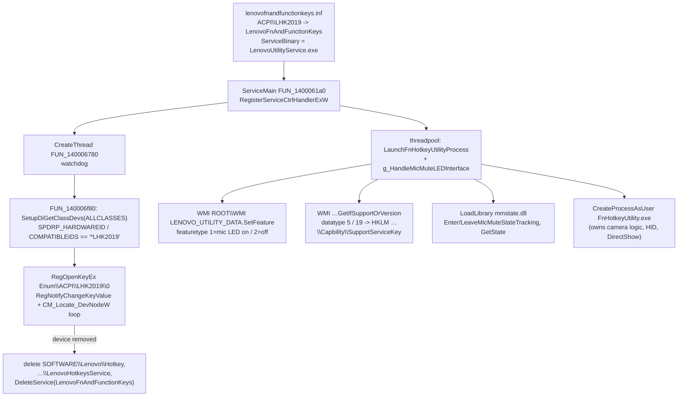

# Task 06 — Ghidra RE of `LenovoUtilityService.exe` + `ControlLib.dll`

Package: **"Lenovo Fn and function keys" v2.0.0.25 (2022-04-25)**, target of `lenovofnandfunctionkeys.inf`
(`AddService = LenovoFnAndFunctionKeys, ..., ServiceBinary = %13%\LenovoUtilityService.exe`, binds `ACPI\LHK2019`).

## 0. Method / tooling / artifacts

| Item | Value |
|---|---|
| Binaries | `10-extracted/code$getextractpath$/source/{lenovoutilityservice.exe,controllib.dll,intelcontrollib.dll}` |
| Decompiler | Ghidra 12.1.2 `/opt/ghidra/support/analyzeHeadless`, JDK 27; 641 functions decompiled for the EXE, 633 for ControlLib, **0 decompile failures** |
| Script | `50-ghidra/scripts/DumpAllScript.java` (dumps blocks, imports, thunks, all functions + C, defined strings with xrefs) |
| Logs | `ghidra-run.log`, `ghidra-run-controllib.log` |

Raw output in this directory (evidence for every claim below):

- `lenovoutilityservice.exe-decomp.c` — full decompiled C (function headers are `//===== <addr> <name> =====`, line numbers cited as `decomp:NNNN`)
- `lenovoutilityservice.exe-strings-xref.txt` — every defined string with its address and xrefs
- `lenovoutilityservice.exe-imports.txt`, `lenovoutilityservice.exe-thunks.txt`, `lenovoutilityservice.exe-blocks.txt`, `lenovoutilityservice.exe-functions.txt`
- `controllib.dll-decomp.c`, `controllib.dll-strings-xref.txt`, `controllib.dll-imports.txt`, `controllib.dll-thunks.txt`, `controllib.dll-blocks.txt`, `controllib.dll-functions.txt`
- `pe-imports-exports.txt` — PE import/export tables for the EXE, ControlLib and IntelControlLib
- String dumps: `70-evidence/strings16-lenovoutilityservice.exe.txt`, `strings-lenovoutilityservice.exe.txt`, `strings16-controllib.dll.txt`

Image bases: EXE `0x140000000`, ControlLib `0x180000000`.

## 1. Headline result

**`LenovoUtilityService.exe` contains no camera logic whatsoever, opens no device path, and issues no IOCTLs.**

It is a service host/supervisor for `FnHotkeyUtility.exe` (`E:\LUT-LENSU-LEN\SvcSrc\LenovoKBDHetkey\...\LenovoUtilityService.pdb`,
`strings-lenovoutilityservice.exe.txt`). Its complete external surface is:

1. **PnP/registry presence check** of the `*LHK2019` ACPI device (SetupAPI + `HKLM\SYSTEM\CurrentControlSet\Enum\…` + `RegNotifyChangeKeyValue`)
   → when the device disappears, it deletes its own registry keys and removes its service.
2. **WMI** on `ROOT\WMI`, class `LENOVO_UTILITY_DATA` (methods `SetFeature`, `GetIfSupportOrVersion`) for the **mic-mute LED** and feature-capability flags.
3. **Launch/terminate `FnHotkeyUtility.exe`** in the interactive session (WTS/CreateProcessAsUser).
4. **Mic-mute state tracking** via `mmstate.dll` (`EnterMicMuteStateTracking`/`LeaveMicMuteStateTracking`/`GetState`).
5. **Registry config**: `…\Services\LenovoFnAndFunctionKeys\{Capbility,ControlShowOSD}`, `SOFTWARE\Lenovo\{Hotkey,LenovoHotkeysService,LenovoUtility\log}`.
6. A temp log file, console handling, ETW provider `{C0570FC0-24C2-49EF-97EA-6D514F6EE5E3}`, and `-install/-remove/-console` self-service management.

The camera behaviour observed in the package (`CAMERA_BIT7`, `SwitchCameraStatus`, `e_Event_CAMERA_SWITCH_ON/OFF`) lives in
**`FnHotkeyUtility.exe`**, not here (see §2.2).

---

## 2. Answers to the five questions

### 2.1 (Q1) Does it open `\\.\ACPI#…` or any device path? Which IOCTLs?

**No device path is opened and there are no IOCTL control codes at all.**

- `DeviceIoControl` is **not imported** (0 occurrences in `pe-imports-exports.txt`; the full KERNEL32 import list for the EXE is in that file).
- No `\\.\`, `\\?\`, `GLOBALROOT`, `ACPI#`, `HID#` or `USB#` string exists anywhere in the image
  (`grep` over `lenovoutilityservice.exe-strings-xref.txt` → 0 hits; also 0 hits in both string dumps).
- `CreateFileW` is imported but has exactly **4 call sites**, all ordinary files:
  - `decomp:4838` / `decomp:4840` (**FUN_140006bf0** @ `0x140006bf0`) — log file
    `C:\Windows\Temp\_LenovoUtility_\_FnHotkeySvcUtility.log` (built with `GetTempPathW` + `L"%c:\\Windows\\Temp\\_LenovoUtility_"`,
    format string `L"%c:\\Windows\\Temp\\_LenovoUtility_\\_FnHotkeySvcUtility.log "`), opened GENERIC_WRITE/`OPEN_ALWAYS` then `OPEN_EXISTING`.
  - `decomp:28376` / `decomp:28416` — `L"CONOUT$"` for console mode.

  (exactly 4 `CreateFileW` call sites in the whole image — `grep -c CreateFileW …-decomp.c` = 4)

**The only `LHK2019` interaction is a PnP presence check:**

`FUN_140006f80` @ `0x140006f80` (`decomp:4899-5010`) — "find the LHK2019 devnode":

```c
DeviceInfoSet = SetupDiGetClassDevsW((GUID *)0x0,(PCWSTR)0x0,(HWND)0x0,6);   // decomp:4939  *,
                                                                             // DIGCF_ALLCLASSES = 6 (all devices)
...
BVar2 = SetupDiGetDeviceRegistryPropertyW(DeviceInfoSet,&local_50,1,...)     // decomp:4949  SPDRP_HARDWAREID
   ... for each NUL-separated entry: lstrcmpiW(pWVar6, L"*LHK2019") == 0
BVar2 = SetupDiGetDeviceRegistryPropertyW(DeviceInfoSet,&local_50,2,...)     // decomp:4982  SPDRP_COMPATIBLEIDS
   ... same comparison
uVar8 = SetupDiGetDeviceInstanceIdW(DeviceInfoSet,&local_50,param_2,0x104,0); // decomp:4974  -> returns e.g. "ACPI\LHK2019\0"
```

`FUN_140006780` @ `0x140006780` (`decomp:4602-4765`) — "watch the devnode, clean up on removal"; it is started as a thread by
`CServiceBase::ServiceMain` (`FUN_1400061a0` @ `0x1400061a0`, `CreateThread(..., FUN_140006780, ...)` at `decomp:4324`):

```c
pWVar6 = FUN_140006f80(pauVar8, local_228);                                    // decomp:4656  instance-id -> local_228
FUN_140005b70(local_438,0x104,L"%s\\%s",L"System\\CurrentControlSet\\Enum");   // decomp:4657  build "\Enum\<instance-id>"
RegOpenKeyExW(HKEY_LOCAL_MACHINE, local_438, 0, 0x20019 /*KEY_READ*/, &local_4a0);// decomp:4661
local_498 = CreateEventW(...);                                                 // decomp:4663
RegNotifyChangeKeyValue(local_4a0, 1 /*watchSubtree*/, 4 /*REG_NOTIFY_CHANGE_LAST_SET*/, local_498, 1 /*async*/);
                                                                               // decomp:4664 / 4675
do { DVar2 = WaitForMultipleObjects(1,&local_498,0,INFINITE); } while (DVar2 != 0); // decomp:4668
CMP_WaitNoPendingInstallEvents(0xffffffff);                                    // decomp:4683
iVar3 = CM_Locate_DevNodeW(local_448, local_228);                              // decomp:4684
   // CR_SUCCESS(0) => device still present => loop again (Sleep(1000) first time)
   // failure      => device gone        => fall through to teardown
```

Teardown (`decomp:4686-4765`): impersonate the console user (`WTSQueryUserToken`/`ImpersonateLoggedOnUser`/`CreateEnvironmentBlock`) →
delete the **HKCU** trees `SOFTWARE\Lenovo\Hotkey` and `SOFTWARE\Lenovo\LenovoHotkeysService` (`decomp:4733`,`4741`; error string
`L"DeleteSymbolicLink  DeleteRegValue  fail GetLastError: %d"` `decomp:4752`) → then

```c
hSCManager = OpenSCManagerW(NULL,NULL,SC_MANAGER_ALL_ACCESS /*0xf003f*/);      // decomp:4758
hService   = OpenServiceW(hSCManager, L"LenovoFnAndFunctionKeys", DELETE /*0x10000*/); // decomp:4760
DeleteService(hService);                                                        // decomp:4762
```

> Answered: **no device path, no IOCTLs**. `LHK2019` is consumed only as an *existence/lifetime* signal
> (`*LHK2019` compatible ID → `HKLM\SYSTEM\CurrentControlSet\Enum\ACPI\LHK2019\0` watch → `CM_Locate_DevNodeW`).
> There is no ACPI control device and no EC access from user mode here.

[INFERENCE] The `System\CurrentControlSet\Enum` string is only ever reached through the format string at `decomp:4657`;
the literal `ACPI` segment of the path never appears as a string because it comes from `SetupDiGetDeviceInstanceIdW` output.

### 2.2 (Q2) Does it talk to HID? Which device (VID/PID, usage page)?

**No — the service has zero HID access.**

- `HID.DLL`, `HidD_*`, `HidP_*` are **not imported** (`pe-imports-exports.txt`), no `\\?\hid#…` / `\\.\` path exists, and no
  VID/PID/usage-page string or code exists (0 hits for `hid`, `VID_`, `PID_`, `usagepage` in both string dumps; the only
  case-insensitive `lens` match in the whole EXE is the false positive `LUT-LENSU-LEN` inside the PDB path).
- **The `LSK_SetFeature` name is a red herring**: it is the program's own trace text for a **WMI** call, not a HID call.
  `FUN_140002bf0` @ `0x140002bf0` (`decomp:1582-1710`, the mic-mute-LED worker) calls `FUN_1400076d0(...,1/2,...)` and logs:

```
L" g_lsk.LSK_SetFeature(SET_KBD_MIC_LED_ON return failed"      decomp:1669 / 1675
L" g_lsk.LSK_SetFeature(SET_KBD_MIC_LED_OFF return failed"
L" g_lsk.LSK_SetFeature __outParam return 1 "                  decomp:1680
```

  `g_lsk` is a C++ wrapper around the WMI `LSK` feature interface; `LSK_SetFeature` = WMI `LENOVO_UTILITY_DATA::SetFeature`
  (§2.3). The `LSK` naming matches ACPI `WMIU._UID = "LSK20"` and the `LSKD`/`LSKV` EC bytes from `STATE.md`.
  1 = LED ON, 2 = LED OFF (`decomp:1667` vs `1673`; feature-type BSTR `"1"`/`"2"` at `0x14002d6d8`/`0x14002d6dc`).

Contrast (context only, evidence for who *does* own HID — `FnHotkeyUtility.exe`, not this task's binary):
`pe-imports-exports.txt`-style dump of `fnhotkeyutility.exe` shows it imports
`HID.DLL : HidD_GetAttributes, HidD_GetFeature, HidD_GetPreparsedData, HidD_FreePreparsedData, HidP_GetCaps`,
plus `KERNEL32.DeviceIoControl` and `SETUPAPI.SetupDiEnumDeviceInterfaces`, and it reads per-device keys
`Software\Lenovo\Hotkey\VID_17EF&PID_60F6…` / `VID_1915&PID_EEE0` (`70-evidence/strings16-fnhotkeyutility.exe.txt:526-552`).
Its camera path is **DirectShow `IAMCameraControl::Set`**: `CameraPrivacy SwitchCameraStatus pCameraControl[i]->Set Line: %d`
(`strings16-fnhotkeyutility.exe.txt:410-414`), and `CameraPrivacy SwitchCameraStatus ... pMoniker[nIndexCamera]->BindToObject`
(a moniker-enumerated capture device, i.e. the camera filter, `/Video`).

### 2.3 (Q3) Does it use WMI? Which namespace/class/query?

**Yes — over COM (not via `wbem*.dll` imports).** Namespace **`ROOT\WMI`**, class **`LENOVO_UTILITY_DATA`**, no `SELECT` query and no
`ExecNotificationQueryAsync` (the service enumerates one instance and invokes methods on it; it is `FnHotkeyUtility.exe` that runs
`SELECT * FROM LENOVO_UTILITY_EVENT`, per `STATE.md`).

COM setup (`imports`: `ole32.CoCreateInstance/CoInitializeEx/CoInitializeSecurity/CoSetProxyBlanket`, `OLEAUT32.SysAllocString/VariantClear`):

| Item | Address | Value / meaning |
|---|---|---|
| CLSID at `.rdata 0x140021bf8` | used `decomp:56` | `{4590F811-1D3A-11D0-891F-00AA004B2E24}` = **CLSID_WbemLocator** |
| IID at `.rdata 0x140021c08` | used `decomp:56` | `{DC12A687-737F-11CF-884D-00AA004B2E24}` = **IID_IWbemLocator** |
| namespace string `0x14002d690` | `decomp:5163-5167` | `L"ROOT\\WMI"` |
| class string `0x14002d658` | `decomp:5138-5145` (enum), `5298` (SetFeature), `5663` (GetIfSupport) | `L"LENOVO_UTILITY_DATA"` |
| method string `0x14002d6c0` | `decomp:5323` | `L"SetFeature"` |
| in-param `0x14002d6a8` | `decomp:5310` | `L"featuretype"` |
| method string `0x14002d760` | `decomp:5679` | `L"GetIfSupportOrVersion"` |
| in-param `0x14002d748` | `decomp:5671` | `L"datatype"` |
| out-param `0x14002d680` | `decomp:5544` (SetFeature) / `decomp:5151` (unused local) | `L"Data"` |
| instance path | `decomp:5340`, `decomp:5698` | `L"__PATH"` (IWbemClassObject property) |
| ETW provider `0x14002d248` | `FUN_140002e00` | `{C0570FC0-24C2-49EF-97EA-6D514F6EE5E3}` (`EventRegister`) |

`FUN_140001080` @ `0x140001080` (`decomp:34-130`) = `IWbemLocator::ConnectServer`:
`CoCreateInstance(CLSID_WbemLocator, NULL, CLSCTX_INPROC_SERVER=1, IID_IWbemLocator, &param_1[1])` (`decomp:56`), then
vtable `+0x18` = `ConnectServer(SysAllocString(L"ROOT\\WMI"), …)` (`decomp:83`) → `param_1[2]` = `IWbemServices`, then
`CoSetProxyBlanket(..., 10 /*RPC_C_AUTHN_WINNT*/, 0, NULL, 3 /*RPC_C_AUTHN_LEVEL_CALL*/, 3 /*RPC_C_IMP_LEVEL_IMPERSONATE*/, NULL, 0)` (`decomp:89`).

`FUN_1400073a0` @ `0x1400073a0` (`decomp:5088-5220`) = one-time init + instance enum:
`CoInitializeEx(NULL, COINIT_MULTITHREADED=0)` (`decomp:5117`) → `CoInitializeSecurity(NULL,-1,NULL,NULL,0 /*RPC_C_AUTHN_LEVEL_DEFAULT*/,
3 /*RPC_C_IMP_LEVEL_IMPERSONATE*/,NULL,0 /*EOAC_NONE*/,NULL)` (`decomp:5122`) → `IWbemServices::CreateInstanceEnum(BSTR(L"LENOVO_UTILITY_DATA"), 0x30)`
(`decomp:5178`; vtable `+0x90`, `0x30` = `WBEM_FLAG_RETURN_IMMEDIATELY|WBEM_FLAG_FORWARD_ONLY`) →
`IEnumWbemClassObject::Next(WBEM_INFINITE, 1, …)` (`decomp:5183`) → stores the single instance in `param_1[9]`.
It takes `__PATH` from that instance to address `ExecMethod`.

**Method call sequence** — `FUN_1400076d0` @ `0x1400076d0` (`decomp:5223-5590`, `SetFeature`) and `FUN_140007f50` @ `0x140007f50`
(`decomp:5591-…`, `GetIfSupportOrVersion`) follow the canonical WMI pattern, identified by both vtable use and their own trace text:

```c
IWbemServices::GetObject(path, 0, NULL, &pClass, NULL)          // vtable +0x30   decomp:5430  "WMI:ExecMethodWMI get object failed!"
pClass->GetMethod(L"SetFeature", 0, &pInClass, NULL)            //                decomp:5446  "WMI:Get method successfully"
pInClass->SpawnInstance(0, &pInInst)                            //                decomp:5462  "WMI:ExecMethodWMI SpawnInstance failed!"
pInInst->Put(L"featuretype", 0, &VARIANT(BSTR"1"|"2"), 0)       // vtable +0x28   decomp:5468  "WMI:ExecMethodWMI put var failed!"
IWbemServices::ExecMethod(path, L"SetFeature", 0, NULL, pInInst, &pOut, NULL); // vtable +0xC0  decomp:5457
pOut->Get(L"Data", 0, &v, 0)  -> *param_3 = v.lVal (VT_I4 / 8)  //                decomp:5544  (out DWORD)
```

The method arguments/return values are BSTR/VT_I4 (`Ordinal_2`=`SysAllocString`, `Ordinal_8`=`VariantInit`, `local_b0[0]=8`=`VT_I4`,
`Ordinal_9`=`VariantClear`, `decomp:5344-5352`). Re-connect-on-failure path logs
`"WMI:ExecMethodWMI reconnect com server."` (`decomp:5437`, and `decomp:5779` in the `GetIfSupportOrVersion` variant).

Callers:
- `SetFeature(featuretype="1"|"2")` — mic-mute LED: `FUN_140002bf0` (`decomp:1667`/`1673`, LED worker driven by `mmstate.dll`
  `GetState`), `FUN_140004880` (`decomp:3188`/`3224`/`3369`/`3405`, `OnServiceControlHandle` session lock/unlock/logon/logoff/OSD),
  `FUN_140005580` (`decomp:3742`/`3778`, `hMicMuteThread`).
- `GetIfSupportOrVersion(datatype="19"|"5")` — feature capability probe: `FUN_140001a60` @ `0x140001a60`
  (`decomp:726` datatype `0x13`, `decomp:765` datatype `5`; expects returned `Data` == `0x19` and `== 2` respectively, else logs
  `L"get Feature Capbilty failed %d"`, `decomp:734`).

WMI error strings (`0x14002a4c0-0x14002a8a0`, all in `lenovoutilityservice.exe-strings-xref.txt:482-510`):
`"WMI:Connect ConnectServer failed!"`, `"WMI:Connect Server failed!"`, `"WMI:EnumInstances SysAllocString failed!"`,
`"WMI:ExecMethodWMI … get object/get method/put var/SpawnInstance failed"`, `"WMI:Get method successfully"`,
`"WMI:ExecMethodWMI reconnect com server."`, `"ReleaseWmi fatal error!"`, `"Utility:: Get WMI Infomation exception!!!"`.

### 2.4 (Q4) Does it read camera state? Any registry keys / config files?

**No camera state is read anywhere in the service.** Zero occurrences of `camera` / `privacy` / `CAM_` / `SW_CAMERA` in either
string dump or in the decompiled code (`grep -i 'camera\|CAM_' lenovoutilityservice.exe-decomp.c` → nothing; 0 hits for
`camera`/`privacy` in `strings-lenovoutilityservice.exe.txt` and `strings16-…`). The single case-insensitive `lens` hit is a
false positive inside the PDB path `E:\LUT-LENSU-LEN\SvcSrc\…` (`strings-lenovoutilityservice.exe.txt:2238`). The service never
touches the EC, ACPI methods, or the USB camera; it has no `CreateFileW` on any camera-related path.

**Registry keys it touches** (`HKEY_LOCAL_MACHINE = 0xffffffff80000002` for all rows except the two `SOFTWARE\Lenovo\*` rows,
which are **HKCU** `0xffffffff80000001` — the service impersonates the console user first, `decomp:4690-4741`):

| Key | Value | Access | Where |
|---|---|---|---|
| `HKLM\SYSTEM\CurrentControlSet\Services\LenovoFnAndFunctionKeys\Capbility` | `SupportServiceKey` (DWORD) | create+write (`0x2001f`), read (`0x20019`) | `decomp:738-815` (`FUN_140001a60`), helpers `FUN_140005c30` (create+set DWORD), `FUN_140005d00` (read) |
| same | `SupportPanelRefeshRate` | read | `decomp:744`,`757` |
| `HKLM\SYSTEM\CurrentControlSet\Services\LenovoFnAndFunctionKeys\ControlShowOSD` | `ShowCapsNumlkOSD` (DWORD) | create+write | `decomp:3500-3585` (`FUN_140004880`) |
| `HKLM\System\CurrentControlSet\Enum\<LHK2019 instance id>` | (key itself) | open + `RegNotifyChangeKeyValue` watch | `decomp:4657-4675` |
| `HKCU\SOFTWARE\Lenovo\Hotkey` | — | **delete tree** on device removal | `decomp:4733` (call), `FUN_140005db0` (`decomp:4082-4291`, self-recursive via `RegEnumKeyExW`/`RegDeleteKeyW` at `decomp:4239`) |
| `HKCU\SOFTWARE\Lenovo\LenovoHotkeysService` | — | **delete tree** on device removal | `decomp:4741` (same helper) |
| `HKLM\SOFTWARE\Lenovo\LenovoUtility\log` | — | `RegOpenKeyExW` gate before writing the log | `decomp:4882` (`FUN_140006e60`) |

**Files / modules:** only `C:\Windows\Temp\_LenovoUtility_\_FnHotkeySvcUtility.log` (§2.1) and `CONOUT$`.
Dynamically loaded: `mmstate.dll` via `_wmakepath_s(..., L"mmstate", L"dll")` + `LoadLibraryW` + `GetProcAddress`
(`FUN_1400029b0` @ `0x1400029b0`, `decomp:1547-1555`; exports used: `EnterMicMuteStateTracking`, `LeaveMicMuteStateTracking`, `GetState`
— those are exactly the exports listed in `pe-imports-exports.txt` for `mmstate.dll`). No config file is parsed.

[INFERENCE] The `SupportPanelRefeshRate` / `datatype=5|19` capability probing is a display-refresh-rate feature flag; it is read
from WMI and cached in the service key, but the service itself only *stores* the result (the consumer is `FnHotkeyUtility.exe`).
No camera meaning is attached to any of these values.

### 2.5 (Q5) `ControlLib.dll` exports / CLSIDs and the `LHK2019` relationship

**`ControlLib.dll` is Intel's Graphics Control Library (IGCL) device-agnostic loader — there is no relationship with `LHK2019`.**

- Identity: PE32+ x64, 190,352 B, `Subsystem=3` (console), **no CLR header** → native, not a .NET assembly.
  Strings: `"Intel Graphics Control Lib Loader for Intel Graphics"`, `"Intel Graphics Control Lib Loader for Windows(R)"`,
  `"Copyright (C) 2021-22 Intel Corporation"` (`controllib.dll-strings-xref.txt:874-882`).
- **Exports: 86 functions, all `ctl*`, entry points `0x1020…0x2fc0`** (full list in `pe-imports-exports.txt`), e.g.
  `ctlInit`, `ctlClose`, `ctlEnumerateDevices`, `ctlEnumerateDisplayOutputs`, `ctlGetDisplayProperties`,
  `ctlPowerGetLimits`, `ctlFanGetState`, `ctlOverclock*`, `ctlPanelDescriptorAccess`, `ctlSetRuntimePath`, `ctlSoftwarePSR`,
  `ctlWaitForPropertyChange`, `ctlReservedCall`.
- **No CLSIDs / no COM**: there is no `DllGetClassObject` or `DllRegisterServer` export, no COM registration data, no `{…}` GUID strings.
  The only GUIDs it uses are *device interface* GUIDs, e.g. `SetupDiGetClassDevsW(&{1CA05180-A699-450A-9A0C-DE4FBE3DDD89}, NULL, NULL, 0x12)`
  (`controllib.dll-decomp.c:3690`; flags `0x12` = `DIGCF_PRESENT|DIGCF_DEVICEINTERFACE`, GUID read from `.rdata 0x18001ded8`).
- What it does: `RegGetValueW(HKLM, L"SOFTWARE\\Intel\\Display\\IGCL", L"EnableDebugLogs")` (`:3650`), enumerate that interface
  (`SetupDiEnumDeviceInterfaces`/`SetupDiGetDeviceInterfaceDetailW`, `:3700-3720`), accept only paths containing `L"_8086"` or
  `L"Intel"` (`~:3720`), then `LoadLibrary` the per-GPU IGCL implementation (path from class subkey values `Driver` /
  `ControlApiPath` under `SYSTEM\CurrentControlSet\Control\Class\…`, `:2647-2718`) and forward the `ctl*` calls. It does not itself
  touch the kernel driver (its `CreateFileW` import is used only for `L"CONOUT$"`; it has **no** `DeviceIoControl`).
- `IntelControlLib.dll` is the actual per-GPU implementation of the same `ctl*` ABI (87 exports incl. `ctlpvtTestFunction`); it uses
  `GDI32.D3DKMTEscape`/`D3DKMTOpenAdapterFromDeviceName` to reach the Intel KMD.
- **Relationship to `LHK2019`: none.** ControlLib never references `LHK2019`, `ACPI`, `HID` or the camera; it is referenced from
  this package only by `FnHotkeyUtility.exe` (string `ControlLib` at `70-evidence/strings16-fnhotkeyutility.exe.txt:562`; the DLL is
  loaded dynamically — it is not in `fnhotkeyutility.exe`'s import table), for Intel display features (e.g. the panel-refresh-rate flag).

---

## 3. Service lifecycle (context for the LHK2019 question)



Other facts worth recording:

- The EXE is a **console app that also self-installs as a service**: `FUN_1400021f0` @ `0x1400021f0` (`decomp:1123`) handles
  `-install` (creates service name `L"LenovoUtilityService"`, display `L"Lenovo Utility Service"`, `CreateServiceW` `decomp:1296`),
  `-remove` (`OpenServiceW`+`ControlService(STOP)`+`DeleteService`, `decomp:1356-1382`), `-console` (falls through to
  `StartServiceCtrlDispatcherW` at `decomp:1268`). Help strings: `" -install  to install the service."` etc. (`0x14002abf0`).
  Note the two distinct service names: **`LenovoUtilityService`** (what `-install` creates) vs **`LenovoFnAndFunctionKeys`**
  (what the INF registers and what the watchdog deletes).
- It launches/terminates the worker: `IsExistUtilityProcess` (Toolhelp32 `Process32FirstW/NextW`), `SeDebugPrivilege`,
  `TerminateProcess`, `WTSGetActiveConsoleSessionId`/`WTSQueryUserToken`/`CreateProcessAsUserW` for `FnHotkeyUtility.exe`
  (strings `"LaunchFnHotkeyUtilityProcess …"`, `"winsta0\\default"`).
- Session handling: `FUN_140004880` @ `0x140004880` (control handler) reacts to `WTS_CONSOLE_CONNECT/DISCONNECT`,
  logon/logoff, lock/unlock, `SERVICE_CONTROL_POWEREVENT`, and vendor controls `SVC_CTL_SEND_UI_*` (`-UIMERTICSON`, `-UIMERTICSOFF`,
  `SVC_CTL_SEND_UI_CAPSLOCK_ON/OFF` → `ShowCapsNumlkOSD`).
- Telemetry: ETW provider `{C0570FC0-24C2-49EF-97EA-6D514F6EE5E3}` (`FUN_140002e00`, `decomp:1713`) — no network code in the service
  (`WINHTTP` is imported only by `ludp.dll`).

## 4. Consequences for the Linux driver work (task 01–05)

1. **There is no user-mode ACPI/IOCTL protocol to replicate.** The Windows service does not talk to the `LHK2019` device at all —
   it only *watches the PnP node*. Therefore the camera switch state cannot come from `LHK2019` itself; it must come from the
   firmware event path already identified (`WMIU` GUID `CE6C0974-…` / notify `0xD0`, `LSKD`/`LSKV`) or from the EC/`CAMS` bit,
   which `FnHotkeyUtility.exe` consumes. (Consistent with `STATE.md`: `LHK2019` is an empty DSDT device whose only role is to
   trigger installation of this service.)
2. **`SW_CAMERA_LENS_COVER` is not reported by any Lenovo WMI driver here.** The Windows worker toggles the camera through
   DirectShow `IAMCameraControl` and tracks its own state in `Software\Lenovo\Hotkey\…` + `CAMERA_BIT7` — i.e. Windows does **not**
   query a hardware privacy-switch bit for the OSD either; the authority is the firmware event (open questions 1–3 in `STATE.md`
   remain the right ones, and are owned by other tasks).
3. The two WMI items this service *does* use (`LENOVO_UTILITY_DATA.SetFeature`, `GetIfSupportOrVersion` on `ROOT\WMI`) are the
   **LUD/LSK20 mic-LED and capability interface**, i.e. the same family as the upstream `lenovo-wmi-hotkey-utilities` driver
   (GUID `CE6C0974-0407-4F50-88BA-4FC3B6559AD8`) — not the camera GUID `50C76F1F-…` which is absent on this machine.
4. `ControlLib.dll` can be ignored for the camera driver: it is the Intel graphics control library (display features only).

## 5. Explicit inferences / residual uncertainty

- [INFERENCE] WMI vtable offsets are mapped by the standard `IWbemServices`/`IWbemClassObject` layouts (`+0x18` ConnectServer,
  `+0x30` GetObject, `+0x90` CreateInstanceEnum, `+0xC0` ExecMethod; `+0x28` Put on the in-params object). The offsets for
  `GetMethod`/`SpawnInstance` appear as `+0x98`/`+0x78` in the decompiler output (an off-by-`0x10` rendering artifact of the
  `CComPtr` wrapper); the *identities* are nevertheless certain because they are named verbatim by the program's own error strings
  (`"WMI:Get method successfully"`, `"…SpawnInstance failed"`, `"…put var failed"`).
- [INFERENCE] `FUN_140001080`'s `param_2` is the namespace argument (`ConnectServer`); the only caller of note passes the string at
  `0x14002d690` = `ROOT\WMI` (`decomp:5163-5167`).
- [INFERENCE] `FUN_140001a60`'s expected `Data` returns (`0x19` for `datatype=19`, `2` for `datatype=5`) indicate a version/support
  handshake; the exact meaning of `19`/`2` is not recoverable statically (no table in the binary).
- `0x1400072a0`/`0x1400072d0`-style small helpers and the static CRT/RTTI code were not analysed in depth (not relevant to 1–5).
- Not analysed here (outside this brief): the camera implementation inside `FnHotkeyUtility.exe` (DirectShow moniker →
  `IAMCameraControl::Set`, `CAMERA_BIT7`, LSK event plumbing), `ludp.dll`, `mmstate.dll` internals, `blurswitchcs.dll` (.NET).
